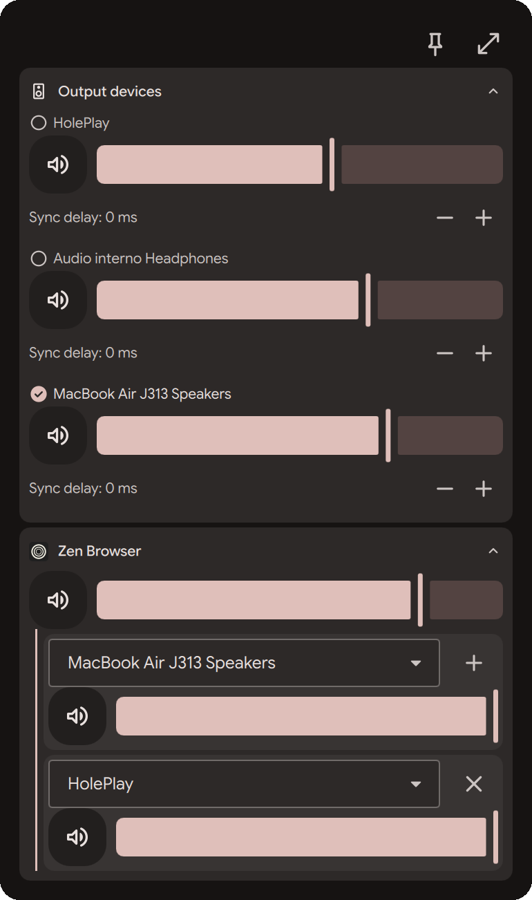

# Dank Mixer

Per-app volume and output routing for [DankMaterialShell](https://github.com/AvengeMedia/DankMaterialShell),
with any app playing on several outputs at once.



> [!WARNING]
> **Alpha.** Dank Mixer works day to day on the author's machine, but it has only
> been tested on one setup (Fedora Asahi, niri, PipeWire + WirePlumber). Expect
> rough edges, and please report what breaks.

## Features

- **One card per stream** playing or recording audio, with its volume: two
  browser tabs get two cards.
- **Choose the output** of each stream, or let it follow the system default.
  New streams of the app go to the last device chosen.
- **Several outputs at once:** send an app to speakers and headphones together,
  each output with its own volume, relative to the app's volume.
- **Latency sync** across outputs: faster outputs wait for the slowest one, and
  the app is told the total delay, so video players stay in sync.
- **Per-device sync delay** in 5 ms steps, for the delay PipeWire doesn't know
  about (often Bluetooth headphones). Saved per device, used by every app.
- **Output devices card:** pick the default output, set each device's volume.
- **Outputs that survive restarts:** routing keeps running when the shell
  restarts or the plugin reloads, so a browser never loses its audio device
  mid-video.
- **Unplugged devices** are skipped, not replaced: an output resumes when its
  device comes back.
- **Works with [Web Popups](https://github.com/etidona/dms-web-popups):** each web
  app gets its own card with its name and icon, and both plugins agree on
  where it plays.
- Folding cards, an expanded view, and a pin to keep the popout open while you
  work elsewhere.

## Requirements

- DankMaterialShell 2.1.0 or later
- PipeWire with WirePlumber, and the PipeWire tools: `pw-loopback`, `pw-metadata`,
  `pw-link`, `pw-cli`
- A systemd user session (`systemd-run`, `systemctl`)

## Install

```sh
git clone https://github.com/etidona/dank-mixer ~/.config/DankMaterialShell/plugins/dankMixer
```

Then in DMS: **Settings → Plugins**, enable **Dank Mixer**, and add its widget to
the bar.

## How it works

An app on a single output is just moved there through WirePlumber's
`target.object` metadata.

An app on several outputs plays into a private virtual sink (its *bus*). Each
output is a `pw-loopback` from the bus monitor to a device. The loopbacks run as
systemd user units named `dankmixer-*.service`, outside the shell's process
group: closing a bus while an app plays into it would stall the app, so they
must outlive shell restarts. The units are part of the graphical session and
stop when you log out.

For latency sync, the plugin reads each device's latency from PipeWire, delays
the faster outputs with `pw-loopback -d`, and declares the slowest latency on
the bus (`ProcessLatency`), which the app sees as its output latency.

How and why it is built this way, in detail: [docs/design.md](docs/design.md).

## Known limitations

- Tested on a single machine only (see the warning above).
- Changing an output's delay restarts that output, so you hear a short gap.
- PipeWire's latency figures for Bluetooth are estimates; use the per-device
  sync delay to fine-tune by ear.
- An app on several outputs is a single card: all its streams (every browser
  tab) play through the same outputs.
- Routing to several outputs is for playback only; recording apps get a
  single input.

## Uninstall

Disable the plugin in **Settings → Plugins**: it moves every app back to a real
device and stops its units. Then delete the plugin folder. If anything is left
over:

```sh
systemctl --user stop 'dankmixer-*'
```

## Roadmap

- MIDI control surfaces: see the [feasibility study](docs/midi-control-surfaces.md).

## License

[MIT](LICENSE)
